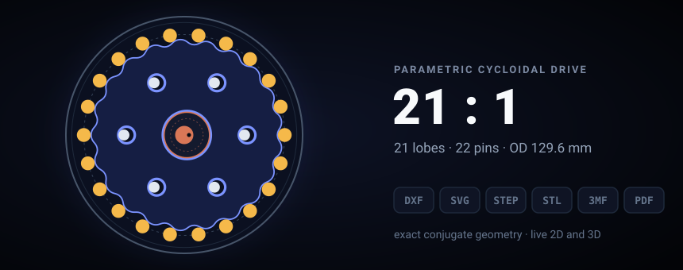
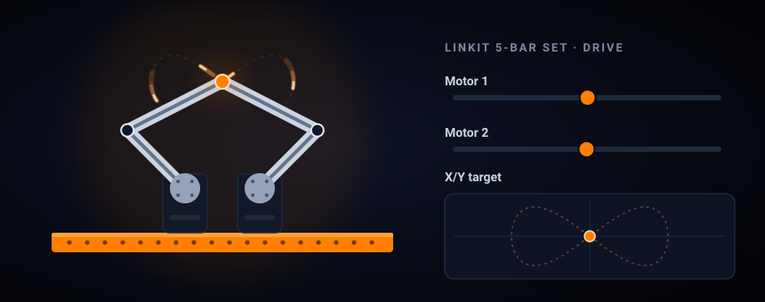

Mechatronics engineer building robots end-to-end: STM32 firmware, PCBs, control and the desktop tools around them.

Currently at [medinstech](https://github.com/medinstech), working on medical rehabilitation and industrial robotics.

MSc @ İKÇÜ · [LinkedIn](https://www.linkedin.com/in/sinantufekci) · [ORCID](https://orcid.org/0009-0009-8654-1628) · [Google Scholar](https://scholar.google.com/citations?user=j362ZEwAAAAJ)

## Projects

<table>
  <tr>
    <td width="50%" valign="top">
      
       
      <b><a href="https://github.com/medinstech/cycloidgen">cycloidgen</a></b> 
      Parametric cycloidal drive generator: exact geometry, live 2D and 3D, design checks, and DXF, STEP, STL and PDF output. Desktop app, CLI and Python library.
    </td>
    <td width="50%" valign="top">
      
       
      <b><a href="https://github.com/medinstech/perfboard-studio">Perfboard Studio</a></b> 
      Desktop EDA for perfboard and stripboard: a schematic netlist goes in, and a placed, autorouted board comes out, checked by DRC and LVS, with a step-by-step soldering guide.
    </td>
  </tr>
  <tr>
    <td width="50%" valign="top">
      
       
      <b><a href="https://github.com/medinstech/linkit-studio-releases">LinKit Studio</a></b> 
      Build a mechanism from LinKit parts on screen, then drive the machine you built. Free for Windows, macOS and Linux.
    </td>
    <td width="50%" valign="top">
      
       
      <b><a href="https://github.com/SinanTufekci/agent-intern">agent-intern</a></b> 
      One MCP server that lets Claude Code drive other coding CLIs as sub-agents: Gemini (Antigravity), Codex, Copilot, Cursor and opencode, plus experimental Grok, Kimi and Muse.
    </td>
  </tr>
</table>

## What I work with

- **Firmware & hardware:** STM32 / C++ firmware · CAN bus · motor control · KiCad PCB design
- **Manufacturing:** CNC / G-code post-processors (Fanuc, Sinumerik)
- **Software:** Python desktop apps (PySide6 + VTK, Nuitka) · MCP servers · MuJoCo · Godot 4
