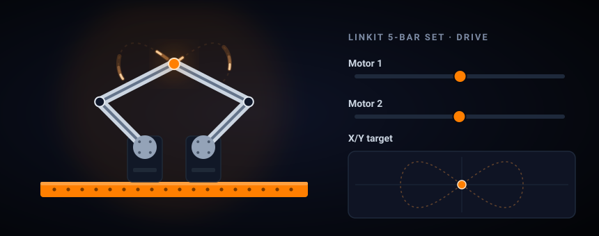

Mechatronics engineer building robots end-to-end: STM32 firmware, PCBs, control and the desktop tools around them.

Currently at [medinstech](https://github.com/medinstech), working on medical rehabilitation and industrial robotics.

MSc @ İKÇÜ · [LinkedIn](https://www.linkedin.com/in/sinantufekci) · [ORCID](https://orcid.org/0009-0009-8654-1628) · [Google Scholar](https://scholar.google.com/citations?user=j362ZEwAAAAJ)

## Projects

<table>
  <tr>
    <td colspan="2" valign="top">
      
       
      <b><a href="https://github.com/SinanTufekci/tabmancer">tabmancer</a></b> 
      Many Claude Code sessions in many terminals, on one screen: what each one is doing and which one waits for you, and every session brought back where it left off, the ones closed before they were done too. Teams of sessions that talk to each other, a way on past usage limits, and Claude Code Wrapped, your week as a card to share, every Friday. Try it with <code>uvx tabmancer --demo</code>. 
       
    </td>
  </tr>
  <tr>
    <td width="50%" valign="top">
      
       
      <b><a href="https://github.com/medinstech/cycloidgen">cycloidgen</a></b> 
      Parametric cycloidal drive generator: exact geometry, live 2D and 3D, design checks, and DXF, STEP, STL and PDF output. Desktop app, CLI and Python library. 
       
    </td>
    <td width="50%" valign="top">
      
       
      <b><a href="https://github.com/medinstech/perfboard-studio">Perfboard Studio</a></b> 
      Desktop EDA for perfboard, stripboard and solderless breadboard: a schematic goes in, and a placed, autorouted board comes out, checked by DRC and LVS, with a step-by-step build guide. 
       
    </td>
  </tr>
  <tr>
    <td width="50%" valign="top">
      
       
      <b><a href="https://github.com/medinstech/linkit-studio-releases">LinKit Studio</a></b> 
      Build a mechanism from LinKit parts on screen, then drive the machine you built. Free for Windows, macOS and Linux. 
       
    </td>
    <td width="50%" valign="top">
      
       
      <b><a href="https://github.com/SinanTufekci/agent-intern">agent-intern</a></b> 
      One MCP server that lets Claude Code drive other coding CLIs as sub-agents: Gemini (Antigravity), Codex, Copilot, Cursor and opencode, plus experimental Grok, Kimi and Muse. 
       
    </td>
  </tr>
</table>

## What I work with

- **Firmware & hardware:** STM32 / C++ firmware · CAN bus · motor control · KiCad PCB design
- **Manufacturing:** CNC / G-code post-processors (Fanuc, Sinumerik)
- **Software:** Python desktop apps (PySide6 + VTK, Nuitka) · terminal apps (Textual) · MCP servers · MuJoCo · Godot 4
